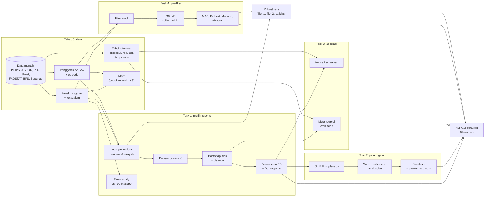

# KAGAMI (Kurs-Associated Grocery Analysis of Markets in Indonesia)

Kagami (鏡) berarti cermin dalam bahasa Jepang. Kami mengukur seberapa jauh harga pangan eceran di Indonesia mengikuti
pergerakan rupiah, dan di komoditas serta provinsi mana hubungan itu paling kuat.

Dokumen ini adalah proposal teknis kami untuk Lomba Data Mining INDONERIS 2026, dengan tema *Realizing Impactful Innovation
through Creative and Sustainable Technology*.

| Anggota                         | Peran                                                                                                                                 |
| ------------------------------- | ------------------------------------------------------------------------------------------------------------------------------------- |
| Danendra Shafi Athallah (ketua) | Tahap 0 (data dan penggerak), estimator nasional, event study, MDE, uji heterogenitas, Kendall, evaluasi Diebold–Mariano, robustness |
| Ardell Aghna Mahendra           | Tabel referensi, deviasi provinsi, bootstrap dan plasebo, penyusutan EB, clustering, meta-regresi, model Task 4, aplikasi, paket juri |
| M. Abizzar Gamadrian            | Naskah makalah dan praregistrasi, data manual, audit klaim, administrasi                                                              |

Semua hasil KAGAMI bersifat asosiasional. Kami tidak meramal kurs, tidak mengamati rantai pasok, dan tidak mengklaim hubungan
sebab-akibat. Jika respons suatu komoditas tidak terdeteksi, kami melaporkannya sebagai batas atas kepekaan.

## Daftar isi

1. [Ringkasan](#1-ringkasan)
2. [Latar belakang dan nilai bisnis](#2-latar-belakang-dan-nilai-bisnis)
3. [Pertanyaan penelitian dan hipotesis](#3-pertanyaan-penelitian-dan-hipotesis)
4. [Data](#4-data)
5. [Alur sistem](#5-alur-sistem)
6. [Metode dan rumus](#6-metode-dan-rumus)
7. [Model yang digunakan](#7-model-yang-digunakan)
8. [Matriks evaluasi](#8-matriks-evaluasi)
9. [Aplikasi untuk analis](#9-aplikasi-untuk-analis)
10. [Cara menjalankan (untuk juri)](#10-cara-menjalankan-untuk-juri)
11. [Struktur repositori](#11-struktur-repositori)
12. [Batasan dan cara menulis hasil](#12-batasan-dan-cara-menulis-hasil)
13. [Hak data dan lisensi](#13-hak-data-dan-lisensi)
14. [Dokumentasi lanjutan](#14-dokumentasi-lanjutan)

## 1. Ringkasan

Pertanyaan yang memandu proyek ini: apakah kepekaan harga pangan eceran terhadap rupiah lebih ditentukan oleh komoditasnya
atau oleh lokasinya?

Untuk menjawabnya, kami membangun panel mingguan harga eceran 10 komoditas pangan di 34 provinsi untuk periode 2018–2026 dari
data turunan PIHPS Bank Indonesia. Kami memasangkan panel itu dengan dua penggerak, yaitu kurs IDR/USD (JISDOR) dan harga dunia
padanan dalam rupiah, lalu menjalankan empat analisis:

| Task | Pertanyaan                                                                                                        | Teknik utama                                                                                                                          |
| ---- | ----------------------------------------------------------------------------------------------------------------- | ------------------------------------------------------------------------------------------------------------------------------------- |
| 1    | Seberapa besar dan cepat harga nasional, wilayah, dan provinsi merespons kurs dan harga dunia dalam 0–12 minggu? | Local projections, event study, bootstrap blok bersama, plasebo geser-melingkar, penyusutan empirical Bayes                           |
| 2    | Apakah respons antarprovinsi berbeda nyata, dan apakah provinsi membentuk kelompok yang stabil?                   | Statistik Q, τ², I² terhadap plasebo dengan FDR; Ward dan silhouette terhadap plasebo; stabilitas bootstrap; uji struktur tertanam |
| 3    | Karakteristik apa yang berasosiasi dengan perbedaan respons?                                                      | Kendall τ-b dengan permutasi eksak, meta-regresi efek acak, panel efek tetap                                                         |
| 4    | Apakah informasi kurs memperbaiki prediksi perubahan harga 4 dan 8 minggu ke depan?                               | Evaluasi rolling-origin as-of, Ridge dan gradient boosting, uji Diebold–Mariano, ablation                                            |

Sejauh penelusuran kami, studi pass-through kurs ke harga pangan Indonesia umumnya memakai indeks harga nasional dan menemukan
efek yang lemah atau tidak terdeteksi. Kami memecah angka agregat itu menjadi komoditas × provinsi × horizon dan menguji setiap
pola terhadap distribusi plasebo. Dengan cara ini, hasil nol pun punya ukuran: kami bisa menyebut selisih terkecil yang akan
terdeteksi bila memang ada.

Kami membekukan hipotesis, parameter, varian komoditas, dan aturan keputusan pada 20 November 2026, sebelum melihat estimasi
(praregistrasi G6; hash konfigurasi tercatat di [docs/PREREGISTRATION.md](docs/PREREGISTRATION.md)). Setiap perubahan sesudah
tanggal itu kami catat sebagai deviasi praregistrasi di [docs/DECISIONS.md](docs/DECISIONS.md).

## 2. Latar belakang dan nilai bisnis

### 2.1 Masalah

Rupiah melemah sepanjang 2026, dan JISDOR mencapai 18.250 per USD pada 16 November 2026. Pemerintah daerah tentu ingin tahu
apakah pelemahan ini akan sampai ke harga pangan di wilayahnya. Studi agregat menemukan pass-through kurs ke harga pangan
Indonesia lemah atau tidak terdeteksi, tetapi angka nasional yang mendekati nol bisa menutupi beberapa komoditas atau provinsi
yang ternyata peka.

### 2.2 Jalur transmisi

Kami memilih komoditas berdasarkan cara kurs bisa mencapai harga eceran:

| Jalur              | Komoditas                                    | Mekanisme                                 |
| ------------------ | -------------------------------------------- | ----------------------------------------- |
| Impor langsung     | Bawang putih, gula pasir, daging sapi, beras | Biaya impor naik saat rupiah melemah      |
| Input impor        | Daging ayam, telur ayam                      | Jagung dan bungkil kedelai untuk pakan    |
| Paritas ekspor     | Minyak goreng                                | Harga sawit dunia dalam rupiah            |
| Domestik (kontrol) | Bawang merah, cabai merah, cabai rawit       | Diproduksi dan dikonsumsi di dalam negeri |

Jalur input impor dan paritas ekspor bergerak lewat harga dunia. Karena itu kami menambahkan penggerak kedua, $w$, yaitu harga
dunia padanan yang dikalikan dengan kurs.

### 2.3 Nilai bagi pengguna

Kami merancang KAGAMI untuk Tim Pengendalian Inflasi Daerah (TPID) dan analis harga di pemerintah daerah atau kantor perwakilan
Bank Indonesia. Proyek ini mendukung ketahanan harga pangan (SDG 2, Zero Hunger).

| Pertanyaan analis                                                                               | Jawaban dari KAGAMI                                                                                         |
| ----------------------------------------------------------------------------------------------- | ----------------------------------------------------------------------------------------------------------- |
| Komoditas mana yang historisnya paling peka terhadap rupiah?                                    | Kurva respons 0–12 minggu per komoditas dengan interval 95%                                                |
| Apakah wilayah saya berbeda dari rata-rata nasional?                                            | Profil 7 wilayah dan deviasi provinsi yang sudah disusutkan, beserta uji apakah perbedaannya melebihi noise |
| Kapan responsnya muncul?                                                                        | Horizon setengah-respons $t_{1/2}$ dan profil per minggu                                                  |
| Jika rupiah melemah 1%, 3%, atau 5%, berapa pergerakan harga yang sejalan dengan pola historis? | Penjelajah skenario bersyarat $PT(h)\cdot x$, berlabel "bukan ramalan"                                    |
| Apakah memantau kurs membantu memperkirakan harga?                                              | Galat prediksi dengan dan tanpa fitur kurs dalam evaluasi pseudo-real-time                                  |

Misalnya, TPID bisa memusatkan pemantauan dan operasi pasar pada komoditas yang responsnya terdeteksi di wilayahnya, lalu
mengatur waktunya sesuai horizon puncak respons. Untuk komoditas yang responsnya tidak terdeteksi, TPID dapat mengalihkan sumber
daya ke risiko lain.

## 3. Pertanyaan penelitian dan hipotesis

| Kode | Pertanyaan                                                                                                                                     | Task  |
| ---- | ---------------------------------------------------------------------------------------------------------------------------------------------- | ----- |
| RQ1  | Seberapa besar dan cepat harga eceran 10 komoditas bergerak bersama IDR/USD dan harga dunia rupiah, dan apakah berbeda menurut jalur eksposur? | 1, 3a |
| RQ2  | Berapa porsi variasi respons yang berasal dari komoditas dibanding provinsi, dan apakah provinsi membentuk kelompok stabil?                    | 1, 2  |
| RQ3  | Apakah respons terhadap depresiasi berbeda dari respons terhadap apresiasi, dan berapa selisih terkecil yang dapat kami deteksi?               | 1     |
| RQ4  | Karakteristik terukur apa yang berasosiasi dengan perbedaan respons?                                                                           | 3     |
| RQ5  | Apakah fitur kurs dan harga dunia memperbaiki prediksi perubahan harga 4 dan 8 minggu out-of-sample?                                           | 4     |

Rincian hipotesis yang kami bekukan di G6 ada di [docs/PREREGISTRATION.md](docs/PREREGISTRATION.md).

| Kode   | Hipotesis                                                                                                            | Uji                                                                       | Jenis                                                                           |
| ------ | -------------------------------------------------------------------------------------------------------------------- | ------------------------------------------------------------------------- | ------------------------------------------------------------------------------- |
| H0-Het | Pada minimal satu komoditas, variasi respons antarprovinsi pada h = 8 lebih besar dari noise ($\tau^2 > 0$)        | Q terhadap distribusi plasebo; FDR Benjamini–Hochberg antar 10 komoditas | Konfirmatori                                                                    |
| H2     | Respons terhadap depresiasi berbeda dari respons terhadap apresiasi                                                  | Wald $\beta^+(8)=\beta^-(8)$, SE cluster minggu                         | Konfirmatori untuk beras dan daging sapi (MDE ≤ 0,5); deskriptif untuk lainnya |
| H3     | Provinsi yang lebih terpencil merespons lebih kecil pada h = 4                                                       | Meta-regresi efek acak, satu arah                                         | Konfirmatori (waktu)                                                            |
| H5     | Untuk jalur impor langsung dan input impor, fitur kurs menurunkan MAE h = 8 pada origin dengan pergerakan kurs besar | Rasio MAE dan Diebold–Mariano HAC, koreksi Holm                          | Konfirmatori untuk grup fokus                                                   |
| E1     | Komoditas impor langsung punya PT(8) lebih besar daripada komoditas domestik                                         | Kendall τ-b, permutasi eksak (10! permutasi)                             | Deskriptif                                                                      |
| E2 | Respons di sekitar perubahan HET/HAP berbeda | LP nasional per rezim HET/HAP, forest plot | Eksploratif |
| E3     | Komoditas yang harganya lebih sering berubah merespons lebih cepat                                                   | Kovariat meta-regresi                                                     | Eksploratif                                                                     |

## 4. Data

### 4.1 Sumber

| Sumber                  | Isi                                                  | Cakupan            | Peran                                |
| ----------------------- | ---------------------------------------------------- | ------------------ | ------------------------------------ |
| PIHPS (Bank Indonesia)  | Harga eceran harian pasar tradisional, 34 provinsi   | 2017-03 .. 2026-11 | Outcome                              |
| JISDOR (Bank Indonesia) | Kurs IDR/USD harian                                  | 2013-05 .. 2026-11 | Penggerak 1                          |
| World Bank Pink Sheet   | Harga komoditas dunia bulanan (USD)                  | 1960 .. 2026-10    | Penggerak 2                          |
| FRED                    | Brent (kontrol), indeks dolar luas (robustness)      | 2013 .. 2026-11    | Kontrol                              |
| FAOSTAT SUA             | Produksi, impor, ekspor                              | 2010 .. 2023       | Rasio impor                          |
| BPS, UN Comtrade        | Impor HS8 bulanan                                    | 2017 .. 2026-09    | Rasio impor bawang putih, cek silang |
| Bapanas                 | Panel harga bulanan, riwayat HET/HAP                 | 2022 .. 2026       | Cek bias, robustness, regulasi       |
| BPS, Kementan           | Produksi padi, konsumsi beras, produksi hortikultura | 2020 .. 2025       | Karakteristik provinsi               |
| Tabel buatan tim        | Regulasi HET/HAP, jarak ke hub, konkordansi HS       | statis             | Referensi                            |

Format, keanehan, dan asal setiap file kami dokumentasikan di [docs/DATASETS.md](docs/DATASETS.md).

### 4.2 Komoditas dan varian representatif

| Komoditas     | Varian PIHPS      | Peran              | Jalur          | Padanan harga dunia          |
| ------------- | ----------------- | ------------------ | -------------- | ---------------------------- |
| Beras         | Kualitas Medium I | lainnya            | impor langsung | Rice, Thai 5%                |
| Bawang putih  | Ukuran Sedang     | fokus              | impor langsung | –                           |
| Gula pasir    | Lokal             | fokus              | impor langsung | Sugar, world                 |
| Minyak goreng | Kemasan Bermerk 1 | fokus              | paritas ekspor | Palm oil                     |
| Daging ayam   | Ras Segar         | fokus (grup pakan) | input impor    | 0,6 Maize + 0,4 Soybean meal |
| Telur ayam    | Ras Segar         | fokus (grup pakan) | input impor    | 0,6 Maize + 0,4 Soybean meal |
| Daging sapi   | Kualitas 1        | fokus              | impor langsung | Beef                         |
| Bawang merah  | Ukuran Sedang     | kontrol            | domestik       | –                           |
| Cabai merah   | Keriting          | kontrol            | domestik       | –                           |
| Cabai rawit   | Merah             | kontrol            | domestik       | –                           |

### 4.3 Panel yang kami bangun

Panel provinsi mingguan berisi 34 provinsi × 10 komoditas × 464 minggu ISO (2018-01-01 sampai 2026-11-16), atau 157.760 sel.
Dari 340 seri, 337 lolos kriteria kelayakan; tiga seri cabai rawit gagal. Kami juga membentuk panel 7 wilayah (Sumatra, Jawa,
Bali–Nusa Tenggara, Kalimantan, Sulawesi, Maluku, Papua) dalam bentuk indeks log relatif terhadap minggu pertama. Dari data kurs,
kami mengidentifikasi 13 episode depresiasi antara 2018 dan 2026, dengan episode terbesar pada Maret–Mei 2020.

## 5. Alur sistem



Setiap kotak menulis artefak dengan kontrak kolom tetap. Kontraknya ada di [src/utils/artifacts.py](src/utils/artifacts.py),
dan salinan tabelnya di [docs/ARCHITECTURE.md](docs/ARCHITECTURE.md). Setiap tahap punya satu modul `kagami.pipelines.<tahap>`,
satu perintah CLI, dan satu notebook. Aplikasi hanya membaca artefak dan tidak menjalankan estimasi apa pun.

Kode kami tersusun berlapis: `utils`, `stats` (mesin statistik numpy/scipy yang kami tulis sendiri), `data`, `features`,
`models`, `evaluation`, lalu `pipelines`; app dan notebook memakai `viz`. Semua angka analisis, seperti ambang, horizon, jumlah
replikasi, dan tanggal, tersimpan di [configs/params.yaml](configs/params.yaml).

## 6. Metode

Notasi: komoditas $i$, provinsi $r$, minggu ISO $t$, horizon $h = 0,\dots,12$. Semua harga memakai log natural. Rumus lengkap
dan detail implementasi ada di [docs/METHODS.md](docs/METHODS.md).

### 6.1 Tahap 0: panel, penggerak, dan daya deteksi

#### Agregasi mingguan

Harga mingguan adalah rerata harga pada hari yang teramati:

$$
p_{i,r,t} = \log\Big(\tfrac{1}{|D_t|}\textstyle\sum_{d \in D_t} P_{i,r,d}\Big)
$$

dengan $D_t$ himpunan hari teramati dalam minggu $t$. Kami memberi setiap sel status `observed`, `carry_forward`, `short`, atau
`missing` sebagai penanda, dan tidak menghapus nilai apa pun.

#### Kelayakan seri

Kami menganggap sebuah seri layak bila porsi minggu `missing` paling banyak 0,20, tidak ada celah lebih dari 8 minggu
berturut-turut, dan setiap tahun kalender terisi minimal 70%.

#### Penggerak kurs

$e_t$ adalah rerata log JISDOR harian dalam minggu $t$, dan $\Delta e_t = e_t - e_{t-1}$. Untuk uji asimetri kami memisahkan
$\Delta e_t^+ = \max(\Delta e_t, 0)$ dan $\Delta e_t^- = \min(\Delta e_t, 0)$.

#### Harga dunia dalam rupiah

Kami membentuk harga dunia komoditas $i$ sebagai komposit seri Pink Sheet $k$ dengan bobot $\omega_k$. Contohnya, harga pakan
memakai 0,6 jagung dan 0,4 bungkil kedelai.

$$
w_{i,t} = \sum_k \omega_k \log P^{\text{USD}}_{k,m(t)} + \bar e_{m(t)}
$$

$m(t)$ adalah bulan dari minggu $t$, dan $\bar e_m$ adalah rerata log JISDOR pada bulan itu. Harga dunia hanya terbit bulanan,
sehingga $\Delta w$ berubah sebulan sekali sementara $\Delta e$ berubah setiap minggu. Perbedaan frekuensi ini mencegah
keduanya kolinear sempurna.

#### Episode depresiasi

Minggu $t$ memicu episode bila $\sum_{s=t-7}^{t} \Delta e_s \ge 0{,}03$. Kami menggabungkan pemicu yang berjarak paling jauh
8 minggu menjadi satu episode.

#### Daya deteksi (MDE)

Kami menghitung MDE sebelum melihat estimasi β. Dengan tingkat signifikansi 5% dan daya 80%:

$$
\text{MDE}_\beta(h) = (z_{0{,}975} + z_{0{,}80})\thinspace \text{SE}_\beta(h) \approx 2{,}80\thinspace \text{SE}_\beta(h), \qquad
\text{MDE}_{PT}(h) = \frac{\text{MDE}_\beta(h)}{\gamma(h)}
$$

$\text{SE}_\beta$ berasal dari bentuk skor di bawah $H_0$, memakai residual LP tanpa kurs dan cluster per minggu. Pada gerbang
G-power, kami memakai angka ini untuk memutuskan apakah LP tetap menjadi analisis utama dan apakah H2 kami uji secara konfirmatori.

### 6.2 Task 1: profil respons

#### Local projections

Kami memakai local projections (Jordà, 2005) dengan lag augmentation untuk setiap komoditas dan horizon:

$$
y^{(h)}_{i,r,t} = \alpha_{i,r,h} + \beta_{i,h}\thinspace \Delta e_t + \omega_{i,h}\thinspace \Delta w_{i,t}
+ \sum_{l=1}^{L}\big(\phi_{l}\thinspace \Delta p_{i,r,t-l} + \psi_{l}\thinspace \Delta e_{t-l} + \chi_{l}\thinspace \Delta w_{i,t-l}\big)
+ \sum_{l=0}^{4}\pi_{l}\thinspace \Delta b_{t-l} + S_{i,h}(t) + u_{i,r,t+h}
$$

$y^{(h)}_{i,r,t} = p_{i,r,t+h} - p_{i,r,t-1}$ adalah perubahan harga kumulatif, dengan $L = 4$ lag (2 dan 8 untuk robustness).
$\alpha_{i,r,h}$ menangkap efek tetap tiap seri lewat within-transform. $\Delta b$ adalah perubahan log harga Brent, dan $S(t)$
berisi dummy bulan serta dummy minggu relatif Idulfitri dari −6 sampai +4. Cara membaca $\beta_{i,h}$: kenaikan 1% IDR/USD
berasosiasi dengan perubahan harga sebesar $\beta_{i,h}$% setelah $h$ minggu.

#### Galat baku cluster per minggu (CR1)

Kurs hanya bervariasi antarminggu, jadi kami melakukan inferensi per minggu:

$$
\hat V = c\thinspace (X^\top X)^{-1}\Big(\sum_{g=1}^{G} X_g^\top \hat u_g \hat u_g^\top X_g\Big)(X^\top X)^{-1},\qquad
c = \frac{G}{G-1}\cdot\frac{n-1}{n-k}
$$

dengan $g$ menunjuk minggu. Kami melaporkan jumlah observasi efektif sebagai jumlah minggu.

#### Rasio pass-through

$\gamma(h)$ adalah respons kumulatif kurs terhadap guncangannya sendiri ($e_{t+h} - e_{t-1}$ pada $\Delta e_t$). Rasio
pass-through mengukur perubahan harga per 1% depresiasi yang masih bertahan sampai minggu $h$:

$$
PT_i(h) = \frac{\beta_{i,h}}{\gamma(h)}
$$

Interval PT kami ambil dari persentil bootstrap.

#### Asimetri (H2)

Kami mengganti $\beta\thinspace \Delta e_t$ dengan $\beta^+\Delta e_t^+ + \beta^-\Delta e_t^-$, lalu menguji $\beta^+(8) = \beta^-(8)$.

#### Event study

Untuk setiap episode yang mulai di minggu $s$, kami menghitung perubahan harga $p_{s+h} - p_{s-1}$ untuk $h = 0..12$ dan
membandingkannya dengan 499 jendela plasebo yang awalnya kami ambil dari minggu di luar episode. Jika $N_{\ge}$ adalah banyaknya
jendela plasebo yang nilai mutlaknya paling sedikit sama dengan nilai mutlak perubahan aktual, p-value-nya adalah

$$
p\text{-value} = \frac{1 + N_{\ge}}{1 + 499}
$$

#### Deviasi provinsi

Kami menghapus guncangan nasional dengan mengurangkan rerata lintas provinsi,
$\tilde p_{i,r,t} = p_{i,r,t} - \frac{1}{|R_t|}\sum_{r'} p_{i,r',t}$, lalu mengestimasi spesifikasi LP yang sama pada
$\tilde p$ untuk setiap provinsi. Hasilnya adalah $\delta_{i,r,h}$ dengan $\sum_r \delta_{i,r,h} = 0$. Respons sebuah provinsi
sama dengan respons nasional ditambah $\delta$.

#### Inferensi bersama

Kami menjalankan moving-block bootstrap dengan blok 13 minggu dan B = 499. Pada setiap replikasi, satu vektor indeks minggu
berlaku untuk harga dan penggerak di semua seri, sehingga korelasi antarprovinsi, antarkomoditas, dan antarhorizon ikut terbawa.

Untuk distribusi null, kami menggeser $\Delta e$ dan $\Delta w$ sejauh $s \in [52, T-52]$ minggu terhadap harga sebanyak R = 499
kali. Pergeseran ini memutus hubungan kurs dan harga tetapi mempertahankan dinamika masing-masing deret.

Interval akhir yang kami laporkan adalah yang lebih lebar di antara $\pm 1{,}96\thinspace \text{SE}$ cluster dan persentil bootstrap
2,5–97,5.

#### Penyusutan empirical Bayes

Untuk setiap kombinasi komoditas, penggerak, dan horizon, kami mengestimasi varians antarprovinsi $\tau^2$ dengan
DerSimonian–Laird (REML sebagai cek), lalu menyusutkan setiap deviasi ke rerata:

$$
\hat\delta^{EB}_r = \mu + \frac{\tau^2}{\tau^2 + s_r^2}\thinspace (\hat\delta_r - \mu)
$$

Provinsi dengan estimasi yang bising ($s_r^2$ besar) tertarik lebih kuat ke rerata. Jika $\tau^2 = 0$, semua provinsi bernilai
sama dengan rerata, dan kami mencatatnya sebagai temuan.

#### Fitur respons

Untuk setiap unit kami menghitung R4, R8, R12 (respons kurs kumulatif), W4, W8, W12 (respons harga dunia), PT8, $t_{1/2}$
(horizon pertama saat respons mencapai 50% dari maksimum), dan A8 = $\beta^+(8) - \beta^-(8)$.

### 6.3 Task 2: peran lokasi

#### Heterogenitas (H0-Het)

Untuk setiap komoditas pada $h = 8$, dengan bobot $v_r = 1/s_r^2$:

$$
Q = \sum_r v_r(\hat\delta_r - \hat\mu)^2,\qquad
\tau^2_{DL} = \max\Big(0,\ \frac{Q - (k-1)}{\sum v_r - \sum v_r^2/\sum v_r}\Big),\qquad
I^2 = \max\Big(0,\ \frac{Q-(k-1)}{Q}\Big)
$$

Lintas komoditas, kami menghitung $\bar\rho$, rerata korelasi vektor deviasi provinsi untuk setiap pasangan komoditas. Kami
membandingkan setiap statistik dengan distribusinya pada 499 replikasi plasebo memakai p satu sisi
$(1 + N_{\ge})/(1 + R)$, dengan $N_{\ge}$ = banyaknya replikasi plasebo yang statistiknya paling sedikit sama dengan nilai aktual.
Setelah itu kami mengoreksinya dengan FDR Benjamini–Hochberg (q ≤ 0,05) antar 10 komoditas.

#### Clustering provinsi

Kami menyusun matriks 34 provinsi × fitur, berisi R dan W pada h = 4, 8, 12 untuk komoditas fokus yang sudah disusutkan.
Setelah z-score per kolom, kami mengelompokkan provinsi dengan Ward (Euclidean) dan menghitung silhouette untuk
$k \in \lbrace 2,\dots,6 \rbrace$:

$$
s(j) = \frac{b(j) - a(j)}{\max\lbrace a(j), b(j)\rbrace}
$$

Kami menerima struktur klaster hanya jika silhouette maksimum data asli melampaui persentil 95 silhouette maksimum dari matriks
plasebo. Jika tidak, kami menetapkan $k = 1$ dan menulis "tidak ada struktur regional yang terdeteksi".

#### Stabilitas

Kami mengukur kesepakatan Ward dengan K-Means (n_init = 50) memakai Adjusted Rand Index. Kami juga mengulang Ward pada setiap
replikasi bootstrap untuk membentuk matriks ko-asignasi dan Jaccard maksimum per klaster, $J(A,B) = |A\cap B| / |A \cup B|$.
Klaster dengan $J < 0{,}6$ kami tandai sebagai pola lemah. Terakhir, kami membandingkan partisi dengan zona HET beras, Jawa dan
luar Jawa, serta 7 wilayah.

#### Uji struktur tertanam

Uji ini mengukur batas deteksi. Kami mengambil matriks plasebo yang realistis, membagi provinsi secara acak ke $k_{true}$
kelompok, lalu menggeser setiap kelompok hingga selisih RMS per fitur antar kelompok sama dengan
$\delta \in \lbrace 0{,}1,\dots,0{,}5 \rbrace$. Kami lalu menghitung
$\text{recovery} = P(k\ \text{terpilih} = k_{true} \wedge \text{ARI} \ge 0{,}8)$. Batas deteksi adalah $\delta$ terkecil
dengan recovery minimal 0,8. Angka ini membuat hasil $k = 1$ bisa dibaca sebagai "struktur dengan selisih ≥ δ akan terdeteksi".

### 6.4 Task 3: karakteristik yang berasosiasi

#### 3a. Kendall τ-b level komoditas (E1)

Kami mengaitkan PT(8) nasional dengan rasio impor langsung:

$$
\text{rasio impor}_i = \frac{\text{impor}_i}{\text{produksi}_i + \text{impor}_i - \text{ekspor}_i}\quad\text{(rerata 2018–2023, FAOSTAT SUA)}
$$

FAOSTAT tidak memuat bawang putih kering, jadi untuk bawang putih kami memakai impor BPS dan Comtrade serta produksi ATAP.
Karena hanya ada 10 komoditas, kami menghitung p-value secara eksak atas seluruh $10! = 3.628.800$ permutasi dan menambahkan
analisis leave-one-commodity-out. Kesimpulan uji ini berlaku untuk 10 komoditas yang kami amati.

#### 3b. Meta-regresi efek acak (H3)

Kami meregresikan deviasi provinsi pada paling banyak 3 fitur yang sudah kami praregistrasi:

$$
\hat\delta_{i,r,h} = b_0 + \sum_{k} b_k Z_k(r) + u_r + \varepsilon_r,\qquad u_r \sim N(0,\tau^2),\ \varepsilon_r \sim N(0, s_r^2)
$$

$Z_1$ adalah keterpencilan, $\ln(1 + \text{jarak km ke hub terdekat})$, dengan Jakarta, Surabaya, dan Makassar sebagai hub dan
jarak great-circle sebagai ukuran. $Z_2$ adalah kecukupan produksi beras, dan $Z_3$ adalah jumlah kota sampel PIHPS. Kami
melaporkan interval yang lebih lebar di antara bootstrap blok mingguan dan SE cluster provinsi CR2, ditambah jackknife per
provinsi.

#### 3c. Panel efek tetap

Kami mengestimasi interaksi $\Delta e_t \times Z(r)$ dengan efek tetap komoditas × minggu, sehingga koefisiennya hanya
teridentifikasi dari perbedaan antarprovinsi. Analisis ini masuk daftar yang boleh kami potong bila waktu habis.

#### E2. Profil respons per rezim HET/HAP

Kami membagi periode setiap komoditas menjadi rezim, yaitu selang di antara tanggal penetapan atau perubahan harga acuan konsumen
(HET, HAP) yang terverifikasi di tabel regulasi tim. Di setiap rezim kami mengestimasi ulang LP nasional pada h = 4, 8, dan 12, hanya
dengan observasi yang seluruh jendela datanya $[t-(L+1),\ t+h]$ berada di dalam rezim itu. Hasilnya kami tampilkan sebagai forest plot
dan kami bandingkan dengan estimasi sampel penuh. Analisis ini eksploratif. Batas rezim bisa bertepatan dengan peristiwa lain, seperti
lonjakan harga pangan dunia 2022, sehingga perbedaan antarrezim tidak kami atribusikan ke regulasi.

### 6.5 Task 4: nilai prediktif informasi kurs

Targetnya adalah $y_{t}^{(h)} = p_{t+h} - p_t$ untuk $h \in \lbrace 4, 8 \rbrace$ minggu.

Kami memakai desain rolling-origin yang meniru kondisi nyata. Origin jatuh setiap 4 minggu sejak 2021-01-04. Pada origin $o$,
kami melatih model hanya dengan baris yang memenuhi $t + h \le o$, artinya outcome-nya sudah terealisasi saat itu. Kami
menggabungkan harga dunia secara as-of: nilai bulan $m$ baru boleh dipakai mulai hari kerja kedua bulan $m+1$, dan data impor
BPS memakai jeda 45 hari. Kami tidak membagi data secara acak per baris.

| Model   | Isi                                                                                    |
| ------- | -------------------------------------------------------------------------------------- |
| M0      | Prediksi nol (tanpa perubahan)                                                         |
| M1      | Ridge dengan lag $\Delta p$ (1/4/8 minggu), bulan, Idulfitri, Brent                  |
| M2      | M1 ditambah perubahan $\Delta e$ dan $\Delta w$ (1/4/8 minggu) dan penanda episode |
| M3      | HistGradientBoosting dengan fitur M2 ditambah identitas komoditas dan wilayah          |
| M2_nofx | M2 tanpa fitur kurs, untuk ablation                                                    |

Ridge meminimalkan $\lVert y - Xb\rVert^2 + \alpha\lVert b\rVert^2$, dan kami memilih $\alpha$ lewat validasi berbasis waktu di
data latih.

Kami menghitung MAE, RMSE, dan rasionya terhadap M1, baik untuk semua origin maupun untuk origin dengan pergerakan kurs 4 minggu
di atas persentil 80 data latih. Uji Diebold–Mariano kami jalankan pada selisih MAE per origin,
$d_o = \text{MAE}_{M1,o} - \text{MAE}_{M2,o}$, dengan koreksi Harvey–Leybourne–Newbold:

$$
DM = \frac{\bar d}{\sqrt{\widehat{LRV}_{HAC}(d)/n}}\cdot\sqrt{\frac{n + 1 - 2h + h(h-1)/n}{n}}
$$

Untuk H5, kami mengoreksi p-value dua jalur dengan metode Holm. Kami selalu melaporkan jumlah origin dan jumlah origin yang
tidak tumpang tindih.

### 6.6 Robustness dan validasi

Cek Tier 1 wajib kami jalankan: h 8 dibanding 12; lag 2, 4, dan 8; sub-periode sebelum dan sesudah perubahan metode JISDOR
pada 2021-04-05; sampel tanpa Maret–Juni 2020 dan tanpa bulan dengan perubahan Brent ekstrem; dekomposisi
$\Delta e = a + b\thinspace \Delta\text{DXY} + \varepsilon$ menjadi komponen dolar global dan komponen khas rupiah; serta frekuensi bulanan.

Cek Tier 2 bersifat opsional: varian harga lain dalam komoditas yang sama (termasuk minyak goreng curah), harga pada hari
teramati terakhir, urutan jalur eksposur ordinal, dan Panel Harga Bapanas sebagai outcome alternatif.

Untuk validasi V4, kami membandingkan respons yang diimplikasikan LP dengan kelebihan respons di atas median plasebo per episode.
Validasi V2 berupa studi kasus episode depresiasi 2026.

## 7. Model yang digunakan

| Model atau teknik                               | Kegunaan                           | Implementasi                                                    | Alasan                                                                               |
| ----------------------------------------------- | ---------------------------------- | --------------------------------------------------------------- | ------------------------------------------------------------------------------------ |
| Local projections + OLS, SE cluster minggu      | Respons kumulatif 0–12 minggu     | `kagami.models.local_projection`, `kagami.stats.regression` | Tahan terhadap salah spesifikasi dinamika; asimetri dan efek tetap mudah ditambahkan |
| Event study + jendela plasebo                   | Cek per episode tanpa model        | `kagami.models.event_study`                                   | Tidak memakai asumsi linear LP                                                       |
| Moving-block bootstrap, plasebo geser-melingkar | Interval dan distribusi null       | `kagami.evaluation.inference`, `kagami.stats.resampling`    | Menjaga korelasi waktu dan lintas seri                                               |
| DerSimonian–Laird, REML, empirical Bayes       | Heterogenitas dan penyusutan       | `kagami.stats.meta`, `kagami.features.response`             | Memisahkan variasi nyata dari noise estimasi                                         |
| Ward, K-Means, silhouette, ARI, Jaccard         | Pola regional                      | `kagami.models.clustering`, `kagami.evaluation.stability`   | Kami menilai klaster terhadap plasebo dan stabilitasnya                              |
| Kendall τ-b permutasi eksak                    | Asosiasi level komoditas (N = 10)  | `kagami.models.association`                                   | Cocok untuk sampel sangat kecil dan bebas asumsi distribusi                          |
| Meta-regresi efek acak                          | Karakteristik provinsi             | `kagami.models.association`                                   | Memperhitungkan ketidakpastian tiap deviasi                                          |
| Ridge, HistGradientBoosting                     | Prediksi Task 4                    | `kagami.models.forecasting` (scikit-learn)                    | Membandingkan model linear yang kuat dengan model nonlinear                          |
| Diebold–Mariano HAC + HLN, Holm, BH            | Perbedaan akurasi dan uji berganda | `kagami.stats.regression`, `kagami.stats.meta`              | Standar evaluasi prediksi dan kontrol multiplisitas                                  |

Kami menulis mesin statistik sendiri dengan numpy dan scipy, tanpa statsmodels, dan mengujinya terhadap jawaban yang sudah
diketahui di `tests/test_stats.py`.

## 8. Matriks evaluasi

| Aspek              | Ukuran                                                         | Ambang atau aturan                                               |
| ------------------ | -------------------------------------------------------------- | ---------------------------------------------------------------- |
| Kekuatan uji       | MDE β dan PT pada h 4/8/12                                    | MDE PT(8) ≤ 0,5 berarti uji konfirmatori; di atasnya deskriptif |
| Ketepatan estimasi | Interval 95% (yang lebih lebar dari SE cluster dan bootstrap)  | Setiap angka kami laporkan bersama intervalnya                   |
| Heterogenitas      | Q, τ², I², ρ̄ terhadap plasebo                            | q BH ≤ 0,05                                                     |
| Struktur regional  | Silhouette terhadap p95 plasebo, ARI, Jaccard                  | Terima bila s* > p95; Jaccard < 0,6 berarti lemah                |
| Batas deteksi      | Recovery struktur tertanam                                     | δ terkecil dengan recovery ≥ 0,8                               |
| Asosiasi           | τ-b, p eksak, jackknife; koefisien meta-regresi dan interval  | Deskriptif, kecuali H3                                           |
| Prediksi           | MAE, RMSE, rasio terhadap M1, DM HAC, ablation                 | H5: p Holm ≤ 0,05                                               |
| Robustness         | Porsi sel yang estimasi utamanya masuk interval cek alternatif | Dilaporkan per cek                                               |

## 9. Aplikasi untuk analis

Aplikasi Streamlit kami punya enam halaman. Aplikasi ini hanya membaca artefak hasil: tidak ada login, tidak ada unggahan data
pengguna, dan tidak ada estimasi saat dijalankan.

| Halaman                                                | Isi                                                                                                                                                   |
| ------------------------------------------------------ | ----------------------------------------------------------------------------------------------------------------------------------------------------- |
| 1. Ringkasan & Status Data ([app/Home.py](app/Home.py)) | Cakupan data, kelayakan seri, status artefak                                                                                                          |
| 2. Kepekaan Harga Regional                             | Kurva respons nasional, wilayah, dan provinsi, serta peta kepekaan                                                                                    |
| 3. Pola Respons                                        | Uji heterogenitas, klaster (atau k = 1) dengan stabilitasnya, batas deteksi                                                                           |
| 4. Eksposur & Nilai Prediktif                          | Jalur eksposur terhadap PT(8), meta-regresi, rasio MAE Task 4                                                                                         |
| 5. Penjelajah Skenario Bersyarat                       | $\Delta \text{harga} \approx PT(h)\cdot x$ untuk $x \in \lbrace 1, 3, 5 \rbrace$ persen, dengan bendera ekstrapolasi dan label "skenario bersyarat, bukan ramalan" |
| 6. Temuan Penelitian                                   | Ringkasan temuan dalam bahasa analis TPID                                                                                                             |

Setiap grafik mencantumkan sumber, satuan, periode, interval 95%, dan label "asosiasi, bukan kausalitas". Jika interval sebuah
respons memuat nol, aplikasi menampilkan lencana "tidak terdeteksi".

## 10. Cara menjalankan (untuk juri)

### 10.1 Prasyarat

Anda membutuhkan Python 3.10 atau lebih baru (kami mengembangkan dengan 3.13). Instalasi akan memasang numpy, pandas, scipy,
scikit-learn, pyarrow, openpyxl, pyyaml, streamlit, dan plotly.

### 10.2 Instalasi

Dari folder hasil ekstrak zip, jalankan:

```powershell
pip install -e ".[dev]"
```

Untuk melihat sumber data dan artefak yang tersedia:

```powershell
python -m kagami status
```

### 10.3 Tiga tingkat reproduksi

| Tingkat | Tujuan                           | Yang dibutuhkan                                                                | Perintah                                                                            |
| ------- | -------------------------------- | ------------------------------------------------------------------------------ | ----------------------------------------------------------------------------------- |
| A       | Melihat semua hasil              | Zip ini saja, tanpa internet                                                   | `python -m kagami app`                                                            |
| B       | Menjalankan ulang analisis       | Data turunan di dalam zip (panel provinsi dan wilayah, penggerak, harga dunia) | `python -m kagami task1` → `task4` → `task2` → `task3` → `robustness` |
| C       | Membangun ulang dari data mentah | Data mentah dari sumber resmi, sebagian harus diunduh manual                   | `python -m kagami download` → `snapshot` → `stage0`, lalu Tingkat B         |

Untuk Tingkat A, cukup jalankan:

```powershell
python -m kagami app
```

Aplikasi akan terbuka di browser, biasanya di http://localhost:8501.

Untuk Tingkat B, jalankan perintah berikut berurutan. Task 2, Task 3, dan robustness memakai output Task 1, dan robustness juga
memakai output Task 4.

```powershell
python -m kagami task1
```

```powershell
python -m kagami task4
```

```powershell
python -m kagami task2
```

```powershell
python -m kagami task3
```

```powershell
python -m kagami robustness
```

Task 1 paling lama: sekitar 7 detik per replikasi bootstrap atau plasebo, atau 1,5–2 jam di laptop untuk B = R = 499. Task 2
dan Task 4 juga berat. Jika ingin, Anda bisa menjalankan pipeline yang sama lewat notebook di [notebooks/](notebooks/) di Kaggle
atau Colab; langkahnya ada di [docs/NOTEBOOKS.md](docs/NOTEBOOKS.md).

Tingkat C memerlukan data mentah yang tidak boleh kami redistribusikan (lihat bagian 13). Perintah `python -m kagami download`
mengunduh sumber yang tersedia daring dan menampilkan instruksi untuk sumber manual. Anda dapat mencocokkan keaslian file dengan
`data/raw/checksums.csv`.

### 10.4 Pengujian

```powershell
python -m pytest -q
```

Tes kami memeriksa mesin statistik terhadap jawaban yang diketahui, estimator pada data sintetis dengan parameter tertanam,
pencegahan kebocoran di Task 4, kontrak artefak, aplikasi, paket juri, dan kesesuaian dokumen dengan kode. Tes yang memerlukan
data mentah otomatis dilewati jika data mentah tidak ada.

### 10.5 Perintah lain

| Perintah                                | Fungsi                                                                 |
| --------------------------------------- | ---------------------------------------------------------------------- |
| `python -m kagami all`                | Menjalankan semua tahap berurutan (butuh data mentah untuk `stage0`) |
| `python -m kagami robustness --tier2` | Robustness termasuk Tier 2 (butuh data mentah)                         |
| `python -m kagami package`            | Membangun zip juri `dist/kagami_submission.zip`                      |
| `python -m kagami bundle --raw`       | Membuat bundel kode, plus data mentah privat, untuk Kaggle atau Colab  |
| `python -m kagami drive-pull all`     | Mengambil artefak dari folder Drive tim (khusus anggota tim)           |

## 11. Struktur repositori

```
datmin/
├── README.md            proposal teknis ini
├── pyproject.toml       dependensi dan paket `kagami` (isi paket ada di folder src/)
├── configs/             params.yaml (semua angka analisis, beku sejak G6), commodities.yaml, sources.yaml, runtime.yaml
├── data/
│   ├── raw/             data mentah per sumber (tidak dikirim bila tanpa hak redistribusi) + checksums.csv
│   ├── reference/       tabel buatan tim: wilayah, alias provinsi, konkordansi, eksposur, regulasi, fitur provinsi
│   └── processed/       panel mingguan provinsi dan 7 wilayah, penggerak, harga dunia (data turunan)
├── results/             artefak hasil Tahap 0 dan Task 1–4, robustness, findings.md
├── src/                 paket kagami: utils, stats, data, features, models, evaluation, pipelines, viz, cli
├── notebooks/           00_stage0_data sampai 05_robustness (satu per tahap; lokal, Kaggle, Colab)
├── app/                 aplikasi Streamlit 6 halaman
├── tests/               tes pytest
└── docs/                metode, dataset, arsitektur, praregistrasi, keputusan, isu terbuka, rencana kerja
```

## 12. Batasan dan cara menulis hasil

KAGAMI tidak dapat menjawab pertanyaan tentang biaya pengadaan importir, market power, mata uang invoice, siklus persediaan,
rantai distributor, atau efek kausal kurs.

Beberapa batasan data dan desain perlu Anda ketahui saat membaca hasil kami:

- Kurs bersifat nasional dan hanya berubah antarminggu, sehingga informasi kurs berasal dari sekitar 460 minggu. Ratusan ribu
  baris panel tidak menambah informasi itu, dan karena itu kami melakukan inferensi per minggu.
- Harga komoditas yang diatur pemerintah jarang berubah, sehingga banyak sel berstatus `carry_forward`. Kami membaca ini sebagai
  kekakuan harga yang nyata dan tidak memakainya untuk menyaring data.
- Evaluasi Task 4 bersifat pseudo-real-time karena kami tidak punya vintage revisi data.
- Uji level komoditas hanya punya 10 pengamatan, jadi kami memperlakukan E1 sebagai deskriptif.

Kami menulis hasil di makalah, aplikasi, dan temuan dengan aturan berikut:

| Hindari                                                     | Tulis                                                                                                                                                                                 |
| ----------------------------------------------------------- | ------------------------------------------------------------------------------------------------------------------------------------------------------------------------------------- |
| "Pelemahan rupiah menyebabkan harga X naik"                 | "Kenaikan IDR/USD berasosiasi dengan kenaikan harga X sebesar … (interval …), setelah mengendalikan …"                                                                             |
| "KAGAMI memprediksi kenaikan harga"                         | "Skenario bersyarat berdasarkan pola historis"                                                                                                                                        |
| "Komoditas impor lebih rentan"                              | "Di antara 10 komoditas yang diamati, komoditas A dan B menunjukkan PT(8) lebih besar"                                                                                                |
| "Provinsi terbagi menjadi k tipe kepekaan" (tanpa uji null) | "Provinsi membentuk k kelompok yang lolos uji plasebo dengan stabilitas Jaccard …" atau "tidak ada struktur regional yang terdeteksi; struktur dengan selisih ≥ … akan terdeteksi" |
| "Tidak ada pengaruh kurs"                                   | "Pengaruh di atas X dapat dikesampingkan pada horizon 8 minggu"                                                                                                                       |
| "Dataset kami" (untuk PIHPS)                                | "Dataset turunan kami yang dibangun dari PIHPS (Bank Indonesia)"                                                                                                                      |

## 13. Hak data dan lisensi

Kami tidak menyertakan data mentah PIHPS dan JISDOR (Bank Indonesia), BPS, Bapanas, maupun UN Comtrade. Zip ini berisi skrip
unduh, checksum (`data/raw/checksums.csv`), dan keluaran turunan.

Panel mingguan per provinsi adalah dataset turunan kami yang dibangun dari PIHPS (Bank Indonesia). Kami menyertakannya atas izin
Bank Indonesia, yang mencakup redistribusi data turunan.

Pink Sheet (Bank Dunia) dan FAOSTAT berlisensi CC BY 4.0, dan data FRED mengikuti ketentuan FRED. Tabel buatan tim di
`data/reference/` kami rilis dengan lisensi CC BY 4.0, kecuali geometri peta `data/reference/indonesia_provinces.geojson`:
© OpenStreetMap contributors, ODbL 1.0, via geoBoundaries (disederhanakan tim). Rincian per sumber ada di
[docs/DATASETS.md](docs/DATASETS.md).

## 14. Dokumentasi lanjutan

| Dokumen                                             | Isi                                                |
| --------------------------------------------------- | -------------------------------------------------- |
| [docs/PROJECT_OVERVIEW.md](docs/PROJECT_OVERVIEW.md) | Ringkasan desain penelitian                        |
| [docs/METHODS.md](docs/METHODS.md)                   | Spesifikasi metode dan rumus lengkap               |
| [docs/DATASETS.md](docs/DATASETS.md)                 | Sumber data, format, keanehan, hak data            |
| [docs/ARCHITECTURE.md](docs/ARCHITECTURE.md)         | Arsitektur kode, kontrak artefak, cara menjalankan |
| [docs/NOTEBOOKS.md](docs/NOTEBOOKS.md)               | Menjalankan tahap berat di Kaggle atau Colab       |
| [docs/PREREGISTRATION.md](docs/PREREGISTRATION.md)   | Hipotesis dan aturan keputusan yang dibekukan      |
| [docs/DECISIONS.md](docs/DECISIONS.md)               | Log keputusan dan deviasi praregistrasi            |
| [docs/OPEN_ISSUES.md](docs/OPEN_ISSUES.md)           | Isu terbuka dan risiko                             |
| [docs/WORKPLAN.md](docs/WORKPLAN.md)                 | Rencana kerja dan status                           |
| [docs/PEMBAGIAN_TUGAS.md](docs/PEMBAGIAN_TUGAS.md)   | Pembagian tugas tim                                |
| [docs/HANDOFF.md](docs/HANDOFF.md)                   | Format serah-terima antar anggota                  |
