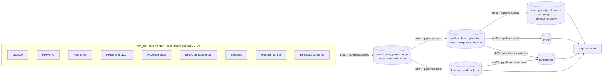

# Arsitektur KAGAMI

Pipeline offline per tahap → artefak (Parquet/CSV/MD) → aplikasi Streamlit yang **hanya membaca** artefak.
Satu tahap = satu modul `kagami.pipelines.<tahap>` = satu notebook = satu perintah CLI.
Kontrak antar-tahap = registry artefak di [`src/utils/artifacts.py`](../src/utils/artifacts.py).
Bila kontrak berubah: ubah registry **dan** tabel §5, lalu `pytest` (tes wiring memeriksa keduanya).

## 1. Alur data



Task 4 hanya butuh Tahap 0 → paralel dengan Task 1.

## 2. Struktur repo (D-026: berlapis)

```
configs/            params.yaml (angka analisis; DIBEKUKAN di G6) · commodities.yaml · sources.yaml (path relatif raw_dir)
                    · runtime.yaml (folder Drive tim, kredensial, folder kerja Colab; bukan parameter analisis)
data/raw/<sumber>/  snapshot mentah lokal (salinan dari/ke Drive tim, D-101), tidak pernah ditimpa; checksums.csv = hash;
                    _superseded/ = versi lama (tidak dipakai, tidak diunggah)
data/reference/     tabel buatan tim (CC BY 4.0): region_crosswalk, province_aliases, + hasil WP-07
data/interim/       antara, boleh dihapus (pihps_daily, forecast_preds)
data/processed/     panel & penggerak mingguan
results/            keluaran analisis per tahap (dibaca app)
notebooks/          00_stage0_data · 01_task1_profiles · 02_task2_patterns · 03_task3_association
                    04_task4_forecast · 05_robustness
src/                paket `kagami` (package-dir di pyproject, D-024)
  cli.py            entry point CLI; PIPELINE = urutan tahap
  utils/            config (lokasi kode/raw/out + yaml), env (runtime lokal/Kaggle/Colab), drive (sinkron Drive tim),
                    artifacts (registry),
                    io (write/read/require artefak), dates (week_start), todo (stub "WP-xx")
  data/             loaders ✔, snapshot ✔, download ✔, weekly ✔ (varian, agregasi, kelayakan),
                    drivers ✔ (penggerak, harga dunia; episode = WP-06), reference, panel (7 wilayah), qa
  features/         response (EB + fitur respons), clustering (matriks fitur), forecast (fitur as-of)
  models/           local_projection, deviations, event_study, clustering (Ward, pilih k),
                    association (Kendall, meta-regresi, FE), forecasting (M0–M3)
  evaluation/       power (MDE), inference (bootstrap, plasebo), heterogeneity, stability, planted,
                    forecast_eval, robustness
  stats/            mesin bersama ✔: regression (OLS cluster, NW, DM), resampling (block bootstrap,
                    circular shift), meta (DL, REML, EB, BH)
  pipelines/        stage0 · task1 · task2 · task3 · task4 · robustness (REQUIRES + run(cfg)) · package (zip juri, bundle)
  viz/              plots: grafik bersama notebook & app
app/                Home.py (hal. 1) + pages/2..6 + common.py
tests/              config · loaders · stats · weekly · drivers · runtime · notebooks · viz · app · wiring · claude_md · handoff · docs_sync · drive · download
docs/               dokumen ini + NOTEBOOKS, WORKPLAN, METHODS, DATASETS, DECISIONS, OPEN_ISSUES, PREREGISTRATION, SESSION_LOG,
                    PEMBAGIAN_TUGAS, HANDOFF + handoff/ (satu file per serah-terima)
```

Aturan lapisan: `data` → `features` → `models` → `evaluation`; `stats` & `utils` dipakai semua lapisan. Hanya
`pipelines` yang mengurutkan langkah dan memanggil `write_artifact`; `viz` hanya membaca artefak.

| Lapisan | Isi | Tidak boleh |
|---|---|---|
| `data` | baca mentah, bersihkan, agregasi, tabel referensi | estimasi model |
| `features` | turunan siap model (fitur respons, matriks clustering, fitur as-of) | membaca file mentah |
| `models` | estimator (LP, event study, clustering, asosiasi, peramalan) | menulis artefak |
| `evaluation` | inferensi, uji, metrik, robustness | menulis artefak |
| `pipelines` | urutan langkah + `require` input + `write_artifact` | logika analisis |

## 3. Runtime: lokal / Kaggle / Colab (D-027)

`Config` memisahkan tiga lokasi; `utils.env.init_runtime()` mengisinya per platform (langkah praktis: [NOTEBOOKS.md](NOTEBOOKS.md)).

| | root (kode) | raw_dir (mentah) | out_dir (tulis) | artifact_dirs (baca tambahan) |
|---|---|---|---|---|
| lokal | folder project | `data/raw` | folder project | – |
| Kaggle | dataset `kagami-code` | dataset `kagami-raw` bila dilampirkan, selain itu `/kaggle/temp/kagami_raw` (pull dari Drive) | `/kaggle/working` | (cadangan) output notebook lain yang ditambahkan sebagai input |
| Colab | `DRIVE_DIR` (project di Google Drive) | `DRIVE_DIR/data/raw` bila ada, selain itu `/content/kagami_raw` (pull dari Drive) | `/content/kagami_out` (`runtime.yaml`) | – |

- Tulis selalu ke `out_dir`; baca dari lokasi pertama yang memuat artefak: `out_dir` → `artifact_dirs` → `root`.
- **Pertukaran antar tahap/anggota lewat folder Drive tim** (https://drive.google.com/drive/folders/15T5ry1VIP_ZhzXqdVAwPLI4vfRySOx8D; D-100): notebook memanggil
  `utils.drive.pull(cfg, <tahap>.REQUIRES)` di awal dan `utils.drive.push(cfg, stages=...)` di akhir; lokal lewat
  `python -m kagami drive-pull/drive-push`. Struktur di Drive = path artefak relatif out_dir. Kredensial: Colab login
  interaktif; Kaggle Secret `KAGAMI_DRIVE_TOKEN`; lokal `~/.kagami/drive_token.json` (`drive-auth`).
- Override manual: env `KAGAMI_ROOT`, `KAGAMI_RAW_DIR`, `KAGAMI_OUT_DIR`, `KAGAMI_ARTIFACT_DIRS` (pemisah `os.pathsep`).
- Sel pertama setiap notebook (identik di semua notebook, dites) menemukan folder kode dan mendaftarkan `kagami`
  tanpa `pip install`; hanya dependensi yang hilang yang dipasang.

## 4. Perintah

| Perintah | Fungsi |
|---|---|
| `pip install -e ".[dev]"` | instal paket + pytest (sekali, lokal) |
| `python -m kagami status` | sumber mentah ada/tidak; artefak ada/belum + lokasi + WP produsen |
| `python -m kagami snapshot` | hash file mentah → `data/raw/checksums.csv` |
| `python -m kagami download [KEY ...]` | Tingkat C: unduh ulang sumber http, bandingkan hash; sumber manual → instruksi |
| `python -m kagami stage0` / `task1` / … / `robustness [--tier2]` | satu tahap (= notebook yang sama) |
| `python -m kagami all` | semua tahap berurutan |
| `python -m kagami bundle [--raw]` | `dist/kagami_code.zip` untuk Kaggle/Colab (+ `kagami_raw_PRIVATE.zip`) |
| `python -m kagami drive-pull [TAHAP/all ...]` | unduh artefak input tahap (atau semua) dari folder Drive tim ke out_dir |
| `python -m kagami drive-push TAHAP ...` | unggah artefak hasil tahap ke folder Drive tim |
| `python -m kagami drive-push-raw` | unggah semua data mentah + checksums ke `data/raw/` Drive tim (MD5 sama dilewati) |
| `python -m kagami drive-pull-raw` | unduh data mentah yang belum ada di raw_dir dari Drive tim (tidak menimpa) |
| `python -m kagami drive-auth --client-secret F` | buat token OAuth Drive (sekali per anggota; isi Kaggle Secret) |
| `python -m kagami package [--allow-missing]` | `dist/kagami_submission.zip` (juri) |
| `python -m kagami app` | Streamlit (Tingkat A) |
| `pytest` | seluruh tes (loader butuh data mentah; di-skip bila tidak ada) |

Stub yang belum diimplementasikan melempar `NotImplementedYet` dengan pesan `WP-xx ... docs/WORKPLAN.md`.

## 5. Registry artefak (kontrak)

| Artefak | Path (relatif out_dir) | Produsen | WP | Kirim | Kolom wajib |
|---|---|---|---|---|---|
| `checksums` | data/raw/checksums.csv | snapshot | WP-01 | ya | source, file, bytes, sha256, retrieved_at, recorded_at |
| `pihps_daily` | data/interim/pihps_daily.parquet | stage0 | WP-03 | tidak | date, province_id, commodity, variant, price |
| `panel_weekly` | data/processed/panel_weekly.parquet | stage0 | WP-03 | ya* | week, province_id, commodity, price, log_price, n_days, status |
| `eligibility` | results/stage0/eligibility.csv | stage0 | WP-04 | ya | province_id, commodity, missing_share, max_gap_weeks, min_year_coverage, eligible |
| `drivers_weekly` | data/processed/drivers_weekly.parquet | stage0 | WP-05 | ya | week, log_e, de, de_pos, de_neg, log_brent, db, log_dxy, d_dxy, month, idf_rel_week, episode |
| `world_prices_weekly` | data/processed/world_prices_weekly.parquet | stage0 | WP-05 | ya | week, commodity, log_w_usd, log_w_idr, dw, available_at |
| `episodes` | results/stage0/episodes.csv | stage0 | WP-06 | ya | episode_id, start_week, end_week, cum_dlog_e |
| `fx_variation` | results/stage0/fx_variation.csv | stage0 | WP-06 | ya | period, n_dep_weeks, n_app_weeks, mean_dep, mean_app, sd_de |
| `concordance` | data/reference/concordance.csv | stage0 | WP-07 | ya | commodity, pihps_name, variant, hs_codes, pinksheet, faostat_items, confidence |
| `exposure` | data/reference/exposure.csv | stage0 | WP-07 | ya | commodity, exposure_path, import_ratio_direct, imported_input_ordinal, world_price_link, source |
| `regulation` | data/reference/regulation.csv | stage0 | WP-07 | ya | commodity, instrument, zone, value_rp, start_date, end_date, regulation, verification |
| `province_features` | data/reference/province_features.csv | stage0 | WP-07 | ya | province_id, dist_hub_km, ln_dist_hub, rice_sufficiency, n_kota |
| `panel_weekly_region` | data/processed/panel_weekly_region.parquet | stage0 | WP-08 | ya | week, region, commodity, log_price_index, n_provinces |
| `mde` | results/stage0/mde.csv | stage0 | WP-09 | ya | commodity, level, horizon, mde_beta, mde_pt |
| `stage0_report` | results/stage0/stage0_report.md | stage0 | WP-10 | ya | (markdown) |
| `profiles` | results/task1/profiles.parquet | task1 | WP-13 | ya | level, unit, commodity, driver, horizon, estimate, se, ci_low, ci_high, n_weeks, shrunk |
| `boot_replicates` | results/task1/boot_replicates.parquet | task1 | WP-16 | ya | rep, level, unit, commodity, driver, horizon, estimate |
| `placebo_stats` | results/task1/placebo_stats.parquet | task1 | WP-16 | ya | rep, level, unit, commodity, driver, horizon, estimate |
| `events` | results/task1/events.parquet | task1 | WP-14 | ya | episode_id, level, unit, commodity, horizon, dlog_price, placebo_lo, placebo_hi, placebo_p |
| `response_features` | results/task1/response_features.parquet | task1 | WP-17 | ya | level, unit, commodity, R4, R8, R12, W4, W8, W12, PT8, t_half, A8 |
| `heterogeneity` | results/task2/heterogeneity.csv | task2 | WP-18 | ya | commodity, horizon, statistic, value, p_placebo, q_fdr |
| `cluster_selection` | results/task2/cluster_selection.csv | task2 | WP-19 | ya | k, silhouette, placebo_p95, accepted |
| `clusters` | results/task2/clusters.parquet | task2 | WP-20 | ya | province_id, method, k, cluster, jaccard, weak |
| `coassign` | results/task2/coassign.parquet | task2 | WP-20 | ya | province_i, province_j, share |
| `partition_compare` | results/task2/partition_compare.csv | task2 | WP-20 | ya | partition, ari, n_groups |
| `planted_recovery` | results/task2/planted_recovery.csv | task2 | WP-21 | ya | delta, k_true, recovery_rate, ari_mean |
| `assoc` | results/task3/assoc.csv | task3 | WP-22 | ya | level, feature, outcome, estimate, ci_low, ci_high, p_value, method, jackknife_min, jackknife_max |
| `forecast_eval` | results/task4/forecast_eval.csv | task4 | WP-27 | ya | horizon, model, subset, commodity, region, mae, rmse, mae_ratio_vs_m1, rmse_ratio_vs_m1, dm_stat, dm_p, n_origins, n_nonoverlap |
| `ablation` | results/task4/ablation.csv | task4 | WP-27 | ya | horizon, commodity, region, mae_full, mae_without_fx, delta_mae |
| `robustness` | results/robustness.csv | robustness | WP-28 | ya | check_id, tier, commodity, horizon, estimate, ci_low, ci_high, baseline_estimate, note |
| `findings` | results/findings.md | report | WP-33 | ya | (markdown) |

\* `panel_weekly` dikirim karena izin BI mencakup redistribusi data turunan (U13, D-104). `pihps_daily` (harga harian per
varian) dan PIHPS mentah tetap tidak dikirim.
`drivers_weekly` punya kolom ekstra `e_filled`, `brent_filled`, `dxy_filled`; `world_prices_weekly` punya `month` (D-025).
`panel_weekly` juga punya kolom ekstra `cf_share` (status `carry_forward` = penanda, bukan filter — U22).

### Konvensi kolom
- `week`: Timestamp Senin awal minggu ISO (`utils.dates.week_start`). Semua join antar sumber memakai ini.
- `commodity`: id internal snake_case dari `configs/commodities.yaml` (bukan nama PIHPS).
- `province_id`: 1–34 (kerangka 34 provinsi lama, urutan PIHPS). `region`: 7 nilai di `region_crosswalk.csv`.
- `level` ∈ {national, region, province}; `unit` = `ALL` / nama wilayah / province_id.
- `driver` ∈ {e, w, e_pos, e_neg, PT}. Satuan respons: Δ log harga per 1 poin log penggerak.
- Harga dalam log natural; perubahan = selisih log (≈ proporsi).

## 6. Tingkat reproduksi (proposal §7.3)

| Tingkat | Input | Perintah | Catatan |
|---|---|---|---|
| A | `results/` yang dikirim | `python -m kagami app` | tanpa internet |
| B | `data/processed/` (termasuk `panel_weekly` provinsi) + `data/reference/` yang dikirim | `task1`–`task4`, `robustness` pada panel provinsi (dan versi wilayah) | lengkap tanpa unduh ulang (D-104) |
| C | unduh ulang mentah | `download` → `snapshot` → `all` | PIHPS diunduh juri sendiri lewat fitur resmi |

`pipelines.task1`, `task3`, `task4` otomatis memakai panel provinsi bila `panel_weekly` ada, selain itu versi wilayah.

## 7. Aturan teknis yang tidak boleh dilanggar
1. File mentah tidak pernah ditimpa/diedit. Snapshot baru = file baru + `snapshot`.
2. Angka analisis hanya dari `configs/params.yaml` / `commodities.yaml`. Tidak ada konstanta tersembunyi di modul.
3. Artefak ditulis hanya lewat `utils.io.write_artifact` dari `pipelines/`. App & notebook hanya membaca.
4. Logika analisis hanya di `src/`. Notebook = setup + `pipelines.<tahap>.run(cfg)` + visualisasi `viz`; simpan tanpa output.
5. Inferensi berbasis minggu: SE di-cluster per minggu; bootstrap/plasebo memakai satu indeks minggu bersama per replikasi.
6. Tidak ada split acak per baris (Task 4: menurut waktu dengan as-of join; jackknife: menurut kelompok).
7. Seed tunggal `params.seed`; setiap RNG dibuat `np.random.default_rng(cfg.seed + offset)` dengan offset terdokumentasi.
8. Data mentah tanpa hak redistribusi tidak masuk zip juri dan hanya boleh diunggah ke dataset Kaggle **privat** / Drive pribadi.
